**English** · [简体中文](README_zh.md) · [繁體中文](README_zh-TW.md) · [日本語](README_ja.md) · [한국어](README_ko.md) · [Türkçe](README_tr.md) · [Русский](README_ru.md) · [Tiếng Việt](README_vi.md) · [ไทย](README_th.md) · [Deutsch](README_de.md) · [Español](README_es.md) · [Français](README_fr.md) · [Українська](README_uk.md) · [Polski](README_pl.md) · [Português (Brasil)](README_pt-BR.md) · [العربية](README_ar.md) · [فارسی](README_fa.md) · [Bahasa Indonesia](README_id.md) · [Italiano](README_it.md) · [Ελληνικά](README_el.md) · [മലയാളം](README_ml.md)

# ANTI-REA

### One MCP for protecting binaries, applications, and core logic against REA.

**Have a core feature you need to protect? Keep it from being analyzed or cloned, down to the binary level.**

[](#anti-rea-evolution-roadmap)
[](#supported-engines)
[](#supported-programming-languages)
[](#quick-start)
[](#quick-start)
[](#supported-engines)
[](../../LICENSE)

Reverse-engineering tools like [REA](https://github.com/morluto/rea) let an agent inspect a binary when you ask *"Understand how this feature works in that app and build a copy for my project."*

**Agentic attack? Meet agentic defense — defense that grows stronger over time.** The ultimate goal of **ANTI-REA** is to **block everything that REA can analyze**. Ask your agent in plain language — *"Protect the core logic in my program so REA can't analyze or clone it"* — and the agent locates your core functions and surrounding clues, compiles them through the Pure-Rust polymorphic VM (`antirea-rust-v12`), verifies that behavior isn't broken, and measures interactive and batch execution speed.

---

## What Gets Protected in Your Software?

- **Core Algorithms & Business Logic:** Prevents proprietary calculations, data processing formulas, and core intellectual property from being decompiled, reverse-engineered, or cloned.
- **Secret Data & Embedded Keys:** Protects sensitive API credentials, encryption keys, tokens, and proprietary constants from being extracted in plaintext from the binary.
- **License & Authorization Checks:** Shields premium feature gates, expiration timers, and product activation checks against cracker bypasses, binary tampering, or forced branch flipping.
- **Anti-Tampering & Memory Dump Defense:** Stops attackers from attaching debuggers, injecting hooks (such as Frida), or dumping live process memory to steal unpacked code.
- **Internal Call Graphs & Execution Flow:** Conceals internal subroutines and API communication paths so competitors and analysts cannot trace the software's structural blueprint.
- **Automated AI Cloning & REA Defense:** Directly neutralizes autonomous AI reverse-engineering agents like REA that inspect binaries to replicate and reimplement your features into competing projects.

---

## Supported Programming Languages

ANTI-REA unifies core logic virtualization across **11 native, managed, and dynamic languages** through its Pure-Rust polymorphic VM compiler (`antirea-rust-v12` via `antirea-cli compile-multilang` and `antirea.rust_multilang`):

| Language | Environment / Runtime | Protection Mechanism (`antirea-rust-v12`) | Deployment Form |
|:---|:---|:---|:---|
| **C** | Clang / MSVC / LLVM | LLVM IR → Kagura VM Lowering → Pure-Rust Polymorphic VM (`antirea-rust-v12`) | Standalone Native Binary (`.exe`) & Native DLL |
| **C++** | Clang++ / MSVC / LLVM | LLVM IR → Kagura VM Lowering → Pure-Rust Polymorphic VM (`antirea-rust-v12`) | Standalone Native Binary (`.exe`) & Native DLL |
| **Rust** | `rustc` / Cargo / LLVM | Rust LLVM IR → Kagura VM Lowering → Pure-Rust Polymorphic VM (`antirea-rust-v12`) | C-ABI & Standalone Protected Native Binary |
| **Swift** | Swift 5.x+ (LLVM Native) | Swift Frontend IR → Kagura VM Lowering → Pure-Rust Polymorphic VM (`antirea-rust-v12`) | Native App Core & Protected Executable |
| **Go** | Go 1.20+ (Typed Native) | Pure-Go Numeric AST Lowering → Pure-Rust Polymorphic VM (`antirea-rust-v12`) | Package Core Separation & Native Binary Link |
| **C# (.NET)** | .NET 8 / 9 (CLR / IL) | C# / CIL Core Lowering → Pure-Rust Polymorphic VM (`antirea-rust-v12`) | Managed App + Protected Native Core (P/Invoke / EXE) |
| **Java** | OpenJDK 17+ / JVM | Java Bytecode / Core Lowering → Pure-Rust Polymorphic VM (`antirea-rust-v12`) | Java Application + JNI / Protected Native Core |
| **Kotlin** | Kotlin 1.9+ / JVM | Kotlin / JVM Core Lowering → Pure-Rust Polymorphic VM (`antirea-rust-v12`) | Kotlin App / JVM Service + Protected Native Core |
| **Python** | Python 3.10 ~ 3.13 | Python AST Core Lowering → Pure-Rust Polymorphic VM (`antirea-rust-v12`) & Mixed Native Bundle | Protected Native Binary / PYD Extension & Module Bundle |
| **JavaScript** | Node.js / Electron / Runtime | JS Core AST Lowering → Pure-Rust Polymorphic VM (`antirea-rust-v12`) & Native Addon Bridge | Protected Native Core & Application Bundle |
| **TypeScript** | TypeScript 5.x+ | Typed TS AST Lowering → Pure-Rust Polymorphic VM (`antirea-rust-v12`) & Native Addon Bridge | Protected Native Core & Transpiled Bundle |

> [!TIP]
> For detailed architectural contracts and language integration specifications, see [Multi-Language Development](../../docs/multilanguage-development.md).

---

## ANTI-REA Evolution Roadmap



- **Phase 1 · Focus on Static Binary Protection [COMPLETED]:** Protects compiled native binaries against static decompilation, Ghidra analysis, and direct formula recovery via control-flow virtualization and layered binary hardening.
- **Phase 2 · Deep Static Hardening [COMPLETED]:** Extends static resilience by camouflaging handler boundaries, scrambling symbol relations, and concealing dispatcher internals.
- **Phase 3 · Scaling Automated Attack Testers [COMPLETED]:** Continuously scales up autonomous attack agent instances, pitting new defense iterations against live automated testers every day to evolve defenses automatically.
- **Phase 4 · Dynamic Protection Hardening & Pure-Rust Engine Evolution [ACTIVE]**
- **Phase 5 · ? [Classified]**
- **Phase 6 · ? [Classified]**
- **Phase 7 · ? [The Frontier]**

---

## Quick start

### Prerequisites

- **Rust Toolchain:** `rustc` / `cargo` 1.75+ targeting `x86_64-pc-windows-msvc` (for building the Pure-Rust defense workspace `rust/` and compiling generated `staticlib` runtimes).
- **LLVM / Clang & Windows SDK:** `clang` / `llvm-objdump` and the MSVC linker (`link.exe`).
- **Python 3.11+:** For the `antirea.defense_mcp` MCP server, multi-language frontends (`antirea.rust_multilang`), and CLI orchestration.

### 1. Set up your agent

No need to touch terminal commands or config files manually. Just ask your agent (Claude Code, Cursor, Codex, Gemini CLI, etc.):

```text
Install ANTI-REA in a local Python virtual environment (.venv), build the release Rust defense engine (cargo build --release --manifest-path rust/Cargo.toml), and connect the antirea.defense_mcp server to your MCP configuration so you can use it right away.
```

### 2. Ask your agent

Once connected, ask your agent in natural language:

```text
Protect the core calculation logic and surrounding clues in my project so REA cannot analyze or clone them, and tell me if the original behavior is intact and what percentage of the original speed it runs at.
```

Or if you already have a built executable and a commercial protector profile:

```text
Create a VMProtect protection plan for app.exe, show it to me first, and run it once I approve.
```

Your agent automatically calls ANTI-REA MCP tools to check available engines (`protection_doctor`), generate a hashed execution plan (`protection_plan`), and run protection after approval (`protection_protect`).

### 3. Use the terminal

Build the Pure-Rust defense engine (`antirea-cli`) and protect single-target or multi-language / multi-module (`@kagura_vm_bc`) LLVM IR inputs:

```powershell
# 1. Build the Pure-Rust defense engine workspace
cargo build --release --manifest-path rust/Cargo.toml

# 2. Protect any multi-language or multi-function (@kagura_vm_bc) LLVM IR into a hardened Rust staticlib
.\rust\target\release\antirea-cli.exe compile-multilang --input-ll <vm_input.ll> --output-dir <out_dir> --seed 90720261101

# 3. Full end-to-end build + 4-gate verification against a reference baseline executable
.\rust\target\release\antirea-cli.exe build --workspace . --input-build <ir_dir> --baseline <baseline.exe> --output-dir <out_dir> --seed 90720261101
```

You can also inspect supported providers and run the MCP server directly from the terminal:

```powershell
.\.venv\Scripts\python.exe -m antirea.defense_mcp --config .runs/protectors.local.json providers
.\.venv\Scripts\python.exe -m antirea.defense_mcp --config .runs/protectors.local.json doctor
```

- [How to Run](../../docs/how-to-run.md) · [Protection Bridge](../../docs/protection-bridge.md) · [Toolchain Setup](../../docs/toolchain.md) · [Reference](../../docs/reference.md)

---

## Multi-Language & Commercial Enterprise Verification (`antirea-rust-v12`)

Every language pipeline and multi-module commercial subsystem protected by `antirea-rust-v12` is validated across our **5-PC parallel external attacker fleet** (REA MCP + Ghidra headless decompilation + dynamic probing) with strict zero-leakage and usability gates:

| # | Language / Target | Frontend → `antirea-rust-v12` Pipeline | VM Blobs / Cluster Handlers | Functional Equivalence | Single-Call Latency | External REA Recovery | Usability Status |
|:-:|:---|:---|:---:|:---:|:---:|:---:|:---:|
| 1 | **C** | Clang `-O1 -emit-llvm` → Kagura VM → `antirea-rust-v12` | 1 / 16 | `100%` | `4.54 ms` | **`0 / 1` (Blocked)** | `USABLE` |
| 2 | **C++** | Clang++ `-std=c++17 -emit-llvm` → Kagura VM → `antirea-rust-v12` | 1 / 16 | `100%` | `4.29 ms` | **`0 / 1` (Blocked)** | `USABLE` |
| 3 | **Rust** | `rustc --emit=llvm-ir` → Kagura VM → `antirea-rust-v12` | 1 / 16 | `100%` | `4.73 ms` | **`0 / 1` (Blocked)** | `USABLE` |
| 4 | **Swift** | `swiftc -emit-ir` → LLVM Normalize → Kagura VM → `antirea-rust-v12` | 1 / 16 | `100%` | `4.50 ms` | **`0 / 1` (Blocked)** | `USABLE` |
| 5 | **Go** | Go AST Lowering → Clang LLVM IR → Kagura VM → `antirea-rust-v12` | 1 / 16 | `100%` | `5.33 ms` | **`0 / 1` (Blocked)** | `USABLE` |
| 6 | **C# (.NET)** | C# Core Lowering → Clang LLVM IR → Kagura VM → `antirea-rust-v12` | 1 / 16 | `100%` | `4.53 ms` | **`0 / 1` (Blocked)** | `USABLE` |
| 7 | **Java** | Java Core Lowering → Clang LLVM IR → Kagura VM → `antirea-rust-v12` | 1 / 16 | `100%` | `3.19 ms` | **`0 / 1` (Blocked)** | `USABLE` |
| 8 | **Kotlin** | Kotlin Core Lowering → Clang LLVM IR → Kagura VM → `antirea-rust-v12` | 1 / 16 | `100%` | `4.77 ms` | **`0 / 1` (Blocked)** | `USABLE` |
| 9 | **Python** | Python AST Lowering → Clang LLVM IR → Kagura VM → `antirea-rust-v12` | 1 / 16 | `100%` | `5.57 ms` | **`0 / 1` (Blocked)** | `USABLE` |
| 10 | **JavaScript** | JS AST Lowering → Clang LLVM IR → Kagura VM → `antirea-rust-v12` | 1 / 16 | `100%` | `4.81 ms` | **`0 / 1` (Blocked)** | `USABLE` |
| 11 | **TypeScript** | TS Typed AST Lowering → Clang LLVM IR → Kagura VM → `antirea-rust-v12` | 1 / 16 | `100%` | `6.97 ms` | **`0 / 1` (Blocked)** | `USABLE` |
| ★ | **Commercial Enterprise Suite** | 4 Subsystems (`LICENSE` · `ENTITLE` · `CLEAR` · `AUDIT`) → `antirea-rust-v12` | **8 / 128** | `100%` (`18,991` tx) | `15.72 ms` | **`0 / 5` (Blocked)** | `USABLE (5/5)` |

---

## How It Works & How It Gets Stronger Daily


### On Your Machine
- **Scope Beyond a Single Function:** Hiding just one function leaves callers and constants exposed. In the LLVM IR path, ANTI-REA traces call graphs and shared data to include surrounding functions that leak clues.
- **Plan Before Execution:** Input hashes and commands are locked into a plan first so the agent never overwrites binaries unexpectedly.
- **Behavior & Usability Speed Measurement:** VM protection inevitably adds overhead. ANTI-REA verifies that outputs match the original binary (`100%` equivalence across thousands of test pairs) and measures both local and attacker-side interactive/batch execution speed (`usability-telemetry.json`) to verify that protected binaries remain responsive (`USABLE`).

### Our Daily Live Attack-Defense Loop
We run a continuous loop between our **Defense Environment** and a **5-PC Parallel External Attack Fleet (REA + Ghidra + Dynamic Emulation)**:

1. **Build & Verify (Pure-Rust Defense Engine):** Apply new Pure-Rust VM/obfuscation passes (`rust/crates/antirea-passes`) and verify 100% output equivalence, PE constant hygiene, and interactive/batch usability bounds (`antirea-validate`).
2. **5-PC Parallel Blind Attack & Usability Telemetry (External Attack Environment):** Share only the **protected EXE and public I/O specification** (never source code or private tests) across 5 isolated attacker PCs. Each attacker PC records live execution speed/usability (`usability-telemetry.json`) and attempts reconstruction using REA MCP + Ghidra + Unicorn, logging exposed anchors and inference steps in `reversing-chain.json`.
3. **Counter-Exploitation & Next-Generation Evolution:** Inspect the incoming `reversing-chain.json` anchors, inference steps, and bottlenecks to eliminate every exposed clue (jump tables, helper call graphs, static XOR slot pairs, terminal tokens, and stack init frames) in the next generation of the Pure-Rust engine.

### Kerckhoffs's Principle: Why Open-Source Defense Remains Resilient Against AI Deobfuscators
Because ANTI-REA is open-source, an attacker (or an autonomous AI agent) can read our entire compiler transformation code (`rust/crates/antirea-passes/src/lib.rs`). By **Kerckhoffs's Principle**, a protection engine must remain secure even when its full source code is public, relying solely on the secrecy of the build `--seed` and the irreversibility of the compiled transformation (`antirea-rust-v12`):

- **One-Way Cryptographic Sponge CSPRNG (`V12-M1`, Zero Seed Inversion):** Unlike reversible PRNGs (`SplitMix64`, LCG, or Xorshift) where extracting a single 64-bit constant from `.rdata` or `.text` lets an attacker invert the PRNG state and recover the master `--seed`, `antirea-passes` (`v12+`) uses a **non-invertible 512-bit (8-word) ChaCha20/BLAKE3-style ARX sponge CSPRNG** (`KerckhoffsSpongeRng`) with irreversible output whitening and state ratcheting. Even if an attacker extracts every constant in the binary and feeds our open-source compiler into an AI, it is mathematically infeasible to invert the PRNG state or derive sibling keys.
- **Per-Build Polymorphic `VmCtx` Layout Shuffling & Bijective Bank Permutations (`V12-M2`):** Reading `lib.rs` does not reveal fixed struct field offsets in the compiled binary. Every build shuffles the `#[repr(C)]` field declaration order of `VmCtx` via Fisher-Yates, randomizes padding array lengths (`pad_lo`, `pad_hi`), and generates build-unique bijective affine permutations for both the 64-slot header (`hdr_ia`/`hdr_ib`) and 1,024-slot arena (`idx_a`/`idx_b`).
- **Polymorphic Opcode Lowering & Superoperator Synthesis (`V12-M3`):** Instead of emitting fixed per-opcode code templates that a known-compiler pattern matcher could classify, each build randomly selects among multiple algebraically equivalent lowering variants (`poly_sel = 0..3`), permutes operand evaluation order, and interleaves self-canceling MBA identities and decoy chaff pulses.
- **Single-Call Inlined Transcript Coupling & Polymorphic `.rdata` Pool (`V12-M4`):** Eliminates small outlined pre/post wrapper functions from `.pdata`, inlining entry-gate derivation and 4-round Feistel return unsealing directly into `@antirea_dispatch_<tag>` while coupling `@antirea_score` via an inline 4-qword stack transcript (`%vm.st`) mutated across the actual dynamic execution path (`VmCtx::set_return`) and a build-polymorphic `.rdata` pool (`rpool_mul`, `rpool_add`, `rpool_unmask`).

**The more protection failures you report through Issues, the stronger ANTI-REA becomes.**

---

## Supported Engines

While the built-in open-source Pure-Rust engine (`ANTI-REA Engine`, `rust/` workspace: `antirea-ir`, `antirea-passes`, `antirea-validate`, `antirea-cli`, currently `antirea-rust-v12`) grows stronger every day across all 11 supported languages and multi-module native binaries, **if you want to combine commercial binary protectors, you can connect Themida, VMProtect, or Code Virtualizer to ANTI-REA and tell your agent in natural language what execution speed and defense level you want.**

```text
Use VMProtect (or Themida / Code Virtualizer) to keep execution speed above 80% of the original while defending the core logic as strongly as possible.
```

| Engine | Connection | Current Status |
|---|---|---|
| **ANTI-REA Engine** | In-house Pure-Rust native protection workspace (`rust/`: `antirea-ir`, `antirea-passes`, `antirea-validate`, `antirea-cli`) & 11-language `compile-multilang` VM pipeline | Active Pure-Rust `antirea-rust-v12` engine: Kerckhoffs 512-bit sponge CSPRNG, polymorphic `VmCtx` layout shuffling, single-call inlined Feistel return sealing, tableless 16-cluster superinstruction VM, split `u128` + SSE2 `XMM` state entanglement, multi-blob commercial application support, and automated 4-gate + attacker usability verification |
| **Themida** | Defense MCP/CLI (`.tmd`/`.tm` project) | Windows native x86/x64 PE adapter implemented (requires local installation) |
| **VMProtect** | Defense MCP/CLI (`.vmp` project) | Windows native x86/x64 PE adapter implemented (requires local installation) |
| **Code Virtualizer** | Defense MCP/CLI (`.cv` project) | Windows native x86/x64 PE adapter implemented (Legacy / v4 supported, requires local installation) |

---

## Development & Testing

Run both the Pure-Rust workspace unit tests and the Python unit/boundary test suite from the repository root:

```powershell
cargo test --manifest-path rust/Cargo.toml
python -m unittest discover -s tests -v
```

Contributions for commercial protector verification, new Rust VM obfuscation passes, general project build integration, and macOS support are welcome. Distributed under the [MIT License](../../LICENSE) (connected third-party protection engines follow their own respective licenses).
