[English](../../README.md) · [简体中文](README_zh.md) · [繁體中文](README_zh-TW.md) · [日本語](README_ja.md) · **한국어** · [Türkçe](README_tr.md) · [Русский](README_ru.md) · [Tiếng Việt](README_vi.md) · [ไทย](README_th.md) · [Deutsch](README_de.md) · [Español](README_es.md) · [Français](README_fr.md) · [Українська](README_uk.md) · [Polski](README_pl.md) · [Português (Brasil)](README_pt-BR.md) · [العربية](README_ar.md) · [فارسی](README_fa.md) · [Bahasa Indonesia](README_id.md) · [Italiano](README_it.md) · [Ελληνικά](README_el.md) · [മലയാളം](README_ml.md)

# ANTI-REA

### 바이너리, 애플리케이션, 핵심 로직을 REA로부터 보호하는 하나의 MCP.

**지키고 싶은 핵심 기능이 있나요? 바이너리 레벨까지 분석·복제되지 않게 보호하세요.**

[](../../CHANGELOG.md)
[](#anti-rea-진화-로드맵)
[-dea584?style=flat-square&logo=rust&logoColor=white)](#지원-엔진)
[](#시맨틱-보호-스코프-및-rsi-계보-추적-nvidia-auto-ontology)
[](#지원-프로그래밍-언어-supported-languages)
[](#빠른-시작)
[](#빠른-시작)
[](#지원-엔진)
[](../../LICENSE)

[REA](https://github.com/morluto/rea) 같은 리버스 엔지니어링 도구는 에이전트에게 *"저 앱의 이 기능이 어떻게 돌아가는지 분석해서 내 프로젝트에 똑같이 만들어줘"*라고 시키면 바이너리를 뜯어보고 원래 로직을 그대로 재구현해냅니다.

**에이전틱 공격? 그럼 우리는 에이전틱 방어 — 시간이 갈수록 점점 강해지는 방어입니다.** **ANTI-REA**의 목표는 **REA가 분석할 수 있는 모든 대상과 분석 방식을 결국 전부 막아내는 것**입니다. 내 에이전트에게 **"내 프로그램의 핵심 기능이 REA에게 분석·복제되지 않도록 보호해줘"**라고 자연어로 말하면, 에이전트가 [NVIDIA Auto Ontology](https://github.com/NVIDIA/auto-ontology) 기반 시맨틱 스코프 분석기로 내부 핫루프 성능 함정을 피해 비밀·경계 함수와 주변 단서만 정밀 선별하고, 순수 Rust 다형성 VM(`antirea-rust-v19`, `Format v19`)으로 가상화·난독화를 걸어 비트 단위 동작 일치와 응답 지연·배치 실행 속도를 검증해 알려줍니다.

---

## 사용자의 소프트웨어에서 무엇이 보호되나요?

- **핵심 알고리즘 & 비즈니스 로직**: 프로그램 고유의 핵심 계산식, 독자적인 데이터 처리 흐름, 영업 비밀 알고리즘이 디컴파일되어 외부에 그대로 유출되거나 복제되지 않도록 보호합니다.
- **비밀 데이터 & 암호화 키**: 코드 내부에 포함된 중요 API 키, 라이선스 시그니처, 보안 토큰, 고유 상수가 `.rdata`나 프롤로그 직후 메모리 스냅샷에서 평문으로 추출되지 않도록 보호합니다.
- **라이선스 및 권한 인증 검증 흐름**: 유료 라이선스 검증, 사용 기한 체크, 계정 인증 로직이 크래커에 의해 우회되거나 강제로 참/거짓 분기가 변조되지 않도록 지킵니다.
- **프로그램 변조 및 동적 메모리·차분 프로빙 방어**: OS `W^X` 정책을 엄격히 준수(`RWX` / `VirtualProtect` 미사용)하면서도 정적 `.rdata` 추출, 실행 중 RAM/스택 스냅샷 덤프, 차분 트레이스 상관분석, Unicorn CPU 단독 핸들러 프로빙을 동시에 차단합니다.
- **내부 동작 구조 및 호출 그래프 은닉**: 다중 채널 래퍼 융합과 리프 헬퍼 완전 인라이닝(클러스터 내부 `call` `0`개), 그리고 빌드마다 달라지는 비고정 클러스터 토폴로지(`12..20`개 클러스터 + 중형 `.pdata` 브리지)로 전체 호출 청사진을 숨깁니다.
- **AI 에이전트에 의한 자동 복제(Cloning) 차단**: 오픈소스 변환기(`rust/crates/antirea-passes`) 전체가 공개된 화이트박스 조건(**케르크호프스의 원칙**)에서도 REA + Ghidra + 동적 에뮬레이션 기반 자율형 AI 역공학 에이전트의 수식 복원 및 복제를 원천 저지합니다.

---

## 지원 프로그래밍 언어 (Supported Languages)

ANTI-REA는 순수 Rust 다형성 VM 컴파일러(`antirea-rust-v19` · `antirea-cli compile-multilang` / `antirea.rust_multilang`)를 통해 **11개 네이티브·관리형(JVM/CLR)·스크립트 언어 전체**의 핵심 로직을 단일 네이티브 다형성 VM 파이프라인으로 통합 보호합니다.

| 프로그래밍 언어 | 지원 환경 / 런타임 | 보호 방식 (`antirea-rust-v19`) | 산출 및 배포 형태 |
|:---|:---|:---|:---|
| **C** | Clang / MSVC / LLVM | LLVM IR → Auto Ontology 스코프 → 순수 Rust 다형성 VM (`antirea-rust-v19`) | 독립 실행 파일(`.exe`) & 네이티브 라이브러리(DLL) |
| **C++** | Clang++ / MSVC / LLVM | LLVM IR → Auto Ontology 스코프 → 순수 Rust 다형성 VM (`antirea-rust-v19`) | 독립 실행 파일(`.exe`) & 네이티브 라이브러리(DLL) |
| **Rust** | `rustc` / Cargo / LLVM | Rust LLVM IR → Auto Ontology 스코프 → 순수 Rust 다형성 VM (`antirea-rust-v19`) | C-ABI 연동 & 독립 보호 네이티브 바이너리 |
| **Swift** | Swift 5.x+ (LLVM Native) | Swift 프론트엔드 IR → Auto Ontology 스코프 → 순수 Rust 다형성 VM (`antirea-rust-v19`) | 네이티브 앱 코어 & 보호 실행 파일 |
| **Go** | Go 1.20+ (Typed Native) | Pure-Go 수치 AST 낮춤 → 순수 Rust 다형성 VM (`antirea-rust-v19`) | 패키지 코어 분리 보호 & 네이티브 바이너리 연동 |
| **C# (.NET)** | .NET 8 / 9 (CLR / IL) | C# / CIL 코어 낮춤 → 순수 Rust 다형성 VM (`antirea-rust-v19`) | 관리형 C# 앱 + 보호 네이티브 코어 (P/Invoke / EXE) |
| **Java** | OpenJDK 17+ / JVM | Java 바이트코드 / 코어 낮춤 → 순수 Rust 다형성 VM (`antirea-rust-v19`) | Java 애플리케이션 + JNI / 보호 네이티브 코어 |
| **Kotlin** | Kotlin 1.9+ / JVM | Kotlin / JVM 코어 낮춤 → 순수 Rust 다형성 VM (`antirea-rust-v19`) | Kotlin 앱 / 서버 서비스 + 보호 네이티브 코어 |
| **Python** | Python 3.10 ~ 3.13 | Python AST 코어 낮춤 → 순수 Rust 다형성 VM (`antirea-rust-v19`) & 하이브리드 번들 | 보호 네이티브 바이너리 / PYD 확장 & 모듈 번들 |
| **JavaScript** | Node.js / Electron / 런타임 | JS 코어 AST 낮춤 → 순수 Rust 다형성 VM (`antirea-rust-v19`) & 네이티브 애드온 브리지 | 보호 네이티브 코어 & 독립 앱 번들 |
| **TypeScript** | TypeScript 5.x+ | 타입 지정 TS AST 낮춤 → 순수 Rust 다형성 VM (`antirea-rust-v19`) & 네이티브 브리지 | 보호 네이티브 코어 & 트랜스파일 번들 |

> [!TIP]
> 언어별 아키텍처 및 세부 통합 스펙은 [다언어 개발 문서](../../docs/multilanguage-development.md)에서 자세히 확인하실 수 있습니다.

---

## ANTI-REA 진화 로드맵



- **Phase 1 · 정적 파일 보호 집중 [완료]:** 바이너리의 정적 디컴파일, Ghidra 분석, 수식 복원을 가상화(VM) 및 다계층 바이너리 하드닝으로 원천 저지합니다.
- **Phase 2 · 정적 보호 강화 [완료]:** 함수별 독립 VM/디스패처 분리, 명령어 융합(Fusion), 바이트코드 무결성 체크섬, 심볼 관계 위장으로 정적 분석을 심층 방어합니다.
- **Phase 3 · 자동 공격 테스터 지속 확장 [완료]:** 별도의 자동 공격 AI 에이전트(Tester) 풀을 지속적으로 늘려 매일 실전 공방 테스트를 거치며 스스로 진화하는 방어 루프를 구축합니다.
- **Phase 4 · 동적 보호 강화, 시맨틱 Auto Ontology 통합 및 순수 Rust `V19` 엔진 진화 [현재 활성화]**
- **Phase 5 · ? [보안 등급 유지]**
- **Phase 6 · ? [보안 등급 유지]**
- **Phase 7 · ? [미지의 영역 - The Frontier]**

---

## 빠른 시작

### 1. 설치 및 에이전트 연결 (`Set up your agent`)

필수 개발 도구(Rust 1.75+ `x86_64-pc-windows-msvc`, LLVM/Clang, MSVC 빌드 도구, Python 3.11+)를 직접 찾아서 설치하거나 터미널 명령어·설정 파일을 만질 필요가 없습니다. 사용 중인 에이전트(Claude Code, Cursor, Codex, Gemini CLI 등)에게 아래처럼 시키면 에이전트가 필수 도구 확인·설치부터 순수 Rust 방어 엔진 빌드 및 방어 MCP(`antirea.defense_mcp`)·읽기 전용 시맨틱 온톨로지 MCP(`antirea.ontology_mcp`) 연결까지 자동으로 수행합니다.

```text
필수 도구(Rust 툴체인, LLVM/Clang, MSVC 빌드 도구, Python 3.11+)가 없으면 알아서 설치해주고, ANTI-REA를 로컬 Python 가상환경(.venv)에 설치한 뒤 순수 Rust 방어 엔진(cargo build --release --manifest-path rust/Cargo.toml)을 빌드해서 네가 바로 쓸 수 있게 antirea.defense_mcp 와 antirea.ontology_mcp 서버를 MCP에 연결해줘.
```

### 2. 에이전트에게 자연어로 시키기 (`Ask your agent`)

설정이 끝나면 복잡한 명령줄 옵션을 외울 필요 없이, 에이전트에게 자연어로 요청하면 됩니다.

```text
내 프로젝트에서 핵심 계산 로직과 주변 단서가 REA에게 분석·복제되지 않도록 Auto Ontology로 핫루프 성능 저하 없이 보호 범위를 잡아서 보호를 걸어주고, 원래 기능이 100% 그대로인지랑 실행 속도가 얼마나 나오는지 알려줘.
```

이미 빌드된 실행 파일과 상용 프로텍터 설정이 있다면 이렇게 요청할 수도 있습니다:

```text
app.exe에 VMProtect로 보호 적용 계획을 먼저 세워서 보여주고, 내가 승인하면 실행해줘.
```

에이전트가 읽기 전용 시맨틱 계층(`antirea.ontology_mcp`의 `recommend_scope`, `check_readiness`)으로 최적 보호 범위를 조회하고, `antirea.defense_mcp` 도구로 연결된 보호 엔진을 점검(`protection_doctor`)한 뒤 해시 고정 계획을 생성(`protection_source_plan` / `protection_plan`)하고, 승인 후 보호 빌드(`protection_source_build` / `protection_protect`) 및 입출력 일치·속도 검증(`protection_source_validate` / `protection_benchmark`)을 수행합니다.

### 3. 터미널에서 직접 쓰기 (`Use the terminal`)

순수 Rust 방어 엔진(`antirea-cli`)을 빌드하고, Auto Ontology로 핫루프 함정을 제외한 보호 스코프를 추천받아 `antirea-rust-v19` 타깃을 컴파일·검증할 수 있습니다:

```powershell
# 1. 순수 Rust 방어 엔진 워크스페이스 릴리스 빌드
cargo build --release --manifest-path rust/Cargo.toml

# 2. 임의의 LLVM IR 모듈에서 내부 핫루프 함정을 배제한 최적 보호 함수 추천 (Auto Ontology)
.\.venv\Scripts\python.exe -m antirea.ontology_mcp --ir <module.ll> recommend-scope --max-slowdown 15

# 3. 선별된 LLVM IR 함수들을 다형성 순수 Rust 정적 라이브러리(antirea-rust-v19)로 컴파일
.\rust\target\release\antirea-cli.exe compile-multilang --workspace . --input-ir <module.ll> --dispatchers <fn1,fn2> --output-dir <out_dir> --seed 90720261105

# 4. 기준(baseline) 및 이전(previous) 실행 파일 대비 엔드투엔드 후보 빌드 + 4대 검증 게이트 실행
.\rust\target\release\antirea-cli.exe build --workspace . --input-build <ir_dir> --baseline <baseline.exe> --previous <prev.exe> --output-dir <out_dir> --seed 90720261105
```

지원 프로텍터 점검, 시맨틱 온톨로지 상태 확인, `NVIDIA/auto-ontology` 업스트림 무중단 동기화, 그리고 28문항 결정론적 A/B 시맨틱 평가도 터미널에서 바로 실행할 수 있습니다:

```powershell
.\.venv\Scripts\python.exe -m antirea.defense_mcp --config .runs/protectors.local.json providers
.\.venv\Scripts\python.exe -m antirea.defense_mcp --config .runs/protectors.local.json doctor
.\.venv\Scripts\python.exe -m antirea.ontology_mcp readiness
.\.venv\Scripts\python.exe -m antirea.auto_ontology_sync sync --check-remote
.\.venv\Scripts\python.exe -m antirea.ontology_eval
```

- [실행 가이드](../../docs/how-to-run.md) · [보호 브리지](../../docs/protection-bridge.md) · [툴체인 설정](../../docs/toolchain.md) · [명령어 레퍼런스](../../docs/reference.md)

---

## 시맨틱 보호 스코프 및 RSI 계보 추적 (NVIDIA Auto Ontology)

실전 오픈소스나 상용 라이브러리에 무작정 전체 VM 가상화를 걸면, 함수 자체에는 루프 백엣지가 없지만 상위 데이터 루프 내부에서 수백만 번 호출되는 리프 보조 함수(`XXH64_round`, `counter_low`, `luaV_shiftl`, `sqlite3VarintLen` 등)까지 가상화되어 `174배`~`41,743배`의 지연 폭발(`UNUSABLE`)이 발생합니다.

ANTI-REA는 **[NVIDIA Auto Ontology](https://github.com/NVIDIA/auto-ontology)**(`v1.2.0`) 및 **`auto-ontology-eval`**(`antirea.ontology`, `antirea.ontology_mcp`, `antirea.auto_ontology_sync`, `antirea.ontology_eval`)을 통합하여 LLVM IR 호출·루프 그래프, 11개 언어 변환 경로, 실전 오픈소스 벤치마크, 그리고 공격 단서(`F0`~`F14`) ↔ 방어 완화(`V15`~`V19`) 계보를 검증된 읽기 전용 SQLite + `AutoOntologyModelDocument` 시맨틱 계층으로 컴파일합니다:

- **무설정(Zero-Config) 추이적 핫루프 탐지:** 수동 정책 파일 없이도 자연 루프 백엣지, 3-홉 추이적 루프 피호출 리프 함수(`called_from_loop` — JVM/Python/JS/TS 컴파일러가 합성한 익명 보조 함수 포함), `antirea-ir` VM 변환 가능 여부를 정적 판별합니다.
- **대수적 대칭 경계 취약점 정적 탐지 및 비가환 프리믹싱 (`ONTO-SYM-V3`):** 경계 함수 내부의 정렬 비트슬라이스 대칭 `XOR`/`ADD` 인자 결합(`has_symmetric_input_mix`)을 사전 포착하고 호출자-피호출자 비가환 모듈러 링 프리믹싱을 자동 결합해 차분 프로빙에 의한 인자 차수 축약을 차단합니다.
- **읽기 전용 SQLite Authorizer 격리 MCP & 무중단 업스트림 동기화:** `antirea.ontology_mcp`는 SQLite 엔진 레벨 `set_authorizer`(`SELECT`/`READ`/`FUNCTION`만 허용, 모든 `INSERT`/`UPDATE`/`DELETE`/`DDL`/`PRAGMA` 원천 차단)로 격리된 10개 읽기 전용 MCP 도구를 제공하며, `antirea.auto_ontology_sync`는 `core.hooksPath=NUL` 보안 조건에서 업스트림 `NVIDIA/auto-ontology` 업데이트를 패스트포워드하고 파괴적 스키마/채점기 변경 시 직전 정상 커밋으로 자동 롤백합니다.
- **`auto-ontology-eval` 28문항 A/B 정량 검증 (`+60.7%p` 향상):** 7개 테이블·3개 난이도(`simple`, `moderate`, `challenging`) 28문항에서 원시 스키마 대조군(`schema-only`)의 `39.3%`(`11/28`) 대비 Auto Ontology 시맨틱 계층이 **`100.0%`(`28/28`, 회귀 `0`건)** 정확도를 달성했습니다.

### 실전 오픈소스 5종 보호 속도 혁신 (`단순 VM` 대비 `Auto Ontology + antirea-rust-v19`)

내부 데이터 루프는 네이티브(`-O2`) 속도로 유지하면서 Auto Ontology가 선별한 비밀 키 파생·경계 마감 함수만 정밀 가상화한 결과, **외부 공격자 단독 복구율 `0%`를 그대로 유지하면서 실행 속도를 `32.4배` ~ `4,345.7배` 가속**했습니다:

| 오픈소스 타깃 | 실전 워크로드 | 단순 핫루프 VM (`Naive`) | **Auto Ontology + `antirea-rust-v19`** | **속도 향상 배율** | 외부 공격자 복구율 |
|:---|:---|---:|---:|---:|:---:|
| **`LZ4`** | 128 KB `LZ4F` 프레임 압축·복원 + 체크섬 | `3,389.67 ms` (`UNUSABLE`) | **`0.78 ms` (`USABLE`)** | **`4,345.7x`** | **`0%` (차단)** |
| **`xxHash`** | 256 KB `XXH64` 스트림 해시 | `1,637.45 ms` (`UNUSABLE`) | **`0.63 ms` (`USABLE`)** | **`2,586.8x`** | **`0%` (차단)** |
| **`Lua 5.4`** | 2,500-라운드 64비트 ARX VM 실행 + GC | `551.00 ms` (`UNUSABLE`) | **`3.00 ms` (`USABLE`)** | **`183.7x`** | **`0%` (차단)** |
| **`BLAKE3`** | 256 KB 키드 머클 트리 청크 스트림 | `323.22 ms` (`UNUSABLE`) | **`3.15 ms` (`USABLE`)** | **`102.7x`** | **`0%` (차단)** |
| **`SQLite 3.46.1`** | 2,000건 B-Tree `INSERT` + 인덱스 조회 (`2,482`개 IR 함수) | `164.13 ms` | **`5.06 ms` (`USABLE`)** | **`32.4x`** | **`0%` (차단)** |

---

## 11개 지원 언어, 오픈소스 및 엔터프라이즈 방어 검증 요약 (`antirea-rust-v19`)

`antirea-rust-v19`(`Format v19`)로 보호된 11개 지원 언어 파이프라인, 323-노드 다중 채널 플래그십 코어, 5대 실전 오픈소스, 상업용 엔터프라이즈 제품군은 **Multi-PC 외부 공격자 병렬 플릿**(REA MCP + Ghidra 헤드리스 디컴파일 + Unicorn CPU 에뮬레이션 + 동적 차분 프로빙)에서 전수 검증되었습니다:

| 순번 | 언어 / 타겟 | 프론트엔드 → `antirea-rust-v19` 파이프라인 | 다형성 클러스터 토폴로지 | 기능 보존 (출력 일치) | 검증된 응답 지연 | 외부 공격자 복원율 | 실사용 판정 |
|:-:|:---|:---|:---:|:---:|:---:|:---:|:---:|
| 1 | **C** | Clang `-O1 -emit-llvm` → ANTI-REA IR → `antirea-rust-v19` | `1` VM / `12..20` 클러스터 | `100%` (`5,198`쌍) | `4.54 ms` | **`0%` (차단)** | `USABLE` |
| 2 | **C++** | Clang++ `-std=c++17 -emit-llvm` → ANTI-REA IR → `antirea-rust-v19` | `1` VM / `12..20` 클러스터 | `100%` (`5,198`쌍) | `4.29 ms` | **`0%` (차단)** | `USABLE` |
| 3 | **Rust** | `rustc --emit=llvm-ir` → ANTI-REA IR → `antirea-rust-v19` | `1` VM / `12..20` 클러스터 | `100%` (`5,198`쌍) | `4.73 ms` | **`0%` (차단)** | `USABLE` |
| 4 | **Swift** | `swiftc -emit-ir` → LLVM 정규화 → ANTI-REA IR → `antirea-rust-v19` | `1` VM / `12..20` 클러스터 | `100%` (`5,198`쌍) | `4.50 ms` | **`0%` (차단)** | `USABLE` |
| 5 | **Go** | Go AST 변환 → Clang LLVM IR → ANTI-REA IR → `antirea-rust-v19` | `1` VM / `12..20` 클러스터 | `100%` (`5,198`쌍) | `5.33 ms` | **`0%` (차단)** | `USABLE` |
| 6 | **C# (.NET)** | C# 코어 변환 → Clang LLVM IR → ANTI-REA IR → `antirea-rust-v19` | `1` VM / `12..20` 클러스터 | `100%` (`5,198`쌍) | `4.53 ms` | **`0%` (차단)** | `USABLE` |
| 7 | **Java** | Java 코어 변환 → Clang LLVM IR → ANTI-REA IR → `antirea-rust-v19` | `1` VM / `12..20` 클러스터 | `100%` (`5,198`쌍) | `3.19 ms` | **`0%` (차단)** | `USABLE` |
| 8 | **Kotlin** | Kotlin 코어 변환 → Clang LLVM IR → ANTI-REA IR → `antirea-rust-v19` | `1` VM / `12..20` 클러스터 | `100%` (`5,198`쌍) | `4.77 ms` | **`0%` (차단)** | `USABLE` |
| 9 | **Python** | Python AST 변환 → Clang LLVM IR → ANTI-REA IR → `antirea-rust-v19` | `1` VM / `12..20` 클러스터 | `100%` (`5,198`쌍) | `5.57 ms` | **`0%` (차단)** | `USABLE` |
| 10 | **JavaScript** | JS AST 변환 → Clang LLVM IR → ANTI-REA IR → `antirea-rust-v19` | `1` VM / `12..20` 클러스터 | `100%` (`5,198`쌍) | `4.81 ms` | **`0%` (차단)** | `USABLE` |
| 11 | **TypeScript** | TS 타입 AST 변환 → Clang LLVM IR → ANTI-REA IR → `antirea-rust-v19` | `1` VM / `12..20` 클러스터 | `100%` (`5,198`쌍) | `6.97 ms` | **`0%` (차단)** | `USABLE` |
| ◆ | **323-노드 다중 채널 플래그십 코어** | 전 프로그램 `f1..f4` 채널 융합 → `antirea-rust-v19` | `1` 융합 VM / `12..20` + 브리지 | `100%` (`5,198`쌍) | `0.37 ms/건` (`2,048`배치 `750 ms`) | **`0%` (차단)** | `USABLE` |
| ★ | **상업용 엔터프라이즈 스위트** | 4대 서브시스템 (`LICENSE` · `ENTITLE` · `CLEAR` · `AUDIT`) → 순수 Rust VM | `8` VM 유닛 / 다형성 구성 | `100%` (`18,991`건) | `15.72 ms` | **`0%` (차단)** | `USABLE` |

---

## 어떻게 작동하고, 어떻게 매일 강해지나요?


### 사용자 PC에서의 작동 흐름
- **단일 함수를 넘어 시맨틱 경계까지 정밀 탐색:** 핵심 함수 1개만 감추면 호출부·상수·대칭 인자 결합에서 단서가 새어나가고, 반대로 내부 핫루프까지 감싸면 속도가 무너집니다. ANTI-REA는 LLVM IR 호출·데이터 그래프와 Auto Ontology 루프 속성을 결합해 성능 손실 없이 숨겨야 할 주변 경계 함수를 정확히 선별합니다.
- **계획 확인 후 안전한 실행:** 에이전트가 임의로 바이너리를 덮어쓰지 못하도록 입력 해시와 실행 명령어를 먼저 지문(Fingerprint) 계획으로 고정하고 승인된 작업만 실행합니다.
- **비트 단위 출력 일치 & 시드 무결성 & 사용성 속도 측정:** 매 빌드마다 수천 개의 테스트 쌍에서 `100%` 비트 일치와 PE 내 시드 바이트 노출 `0`건을 자동 검사하고, 단건 지연 및 배치 처리량(`usability-telemetry.json`)을 측정해 실사용 가능 여부(`USABLE`)를 검증합니다.

### 저희가 매일 돌리는 Multi-PC 병렬 실전 공방 RSI 루프
**방어 전담 환경과 격리된 Multi-PC 외부 공격자 플릿(REA + Ghidra + Unicorn + 동적 차분 프로빙)** 사이에서 지속적인 진화 루프를 운영합니다:

1. **순수 Rust 방어 합성 및 4대 검증 게이트 (`antirea-validate`):** `rust/crates/antirea-passes`에 새로운 다형성 VM·난독화 패스를 합성하고, 입출력 100% 일치·PE 시드/상수 은닉·다중 시드 교차 빌드 비동형성·실행 속도 기준을 검증합니다.
2. **Multi-PC 병렬 블라인드 공격 및 텔레메트리 수집:** 원본 소스·IR·비공개 테스트는 일절 제외하고 **보호된 EXE와 공개 입출력 계약**만 격리된 외부 공격자 PC들에 배포합니다. 각 공격자 PC는 실측 속도(`usability-telemetry.json`)를 기록하고 REA MCP + Ghidra + Unicorn + 메모리/스택 차분 분석으로 복원을 시도하며 관측 단서를 `reversing-chain.json`에 남깁니다.
3. **온톨로지 기반 표적 진화 (`V13` → `V19.0`):** 공격자 체인에서 식별된 구조적 단서(`F0`~`F14`)와 방어 패스(`V15`~`V19`, `ONTO-SYM-V3`)를 Auto Ontology SQLite 계보 테이블에 구조화해 미해결 공격 표면을 다음 세대 엔진에서 원천 소거하고 재검증합니다.

### 케르크호프스의 원칙 (Kerckhoffs's Principle): 오픈소스가 공개되어도 AI 역컴파일러에 뚫리지 않는 이유
ANTI-REA는 오픈소스이므로 공격자(또는 공격자 AI)가 변환 엔진 전체 코드(`rust/crates/antirea-passes/src/lib.rs`)를 그대로 읽을 수 있습니다. **케르크호프스의 원칙**에 따라 `antirea-rust-v19`(`Format v19`)는 오직 빌드 `--seed`의 비밀성과 비가역적 암호학적 합성에만 안전성을 둡니다:

- **RFC 8439 20-라운드 `ChaCha20Csprng` 및 512비트 스폰지 화이트닝 (`V12-M1` / `V13-M1`, 시드 역산 `0`건):** 상수 1개로 내부 상태가 역산되는 `SplitMix64`·LCG·Xorshift를 배제하고 **RFC 8439 20-라운드 `ChaCha20Csprng` 스트림 생성기 + 비가역 512비트 ARX 스폰지 화이트닝**을 사용하며, 링크 직후 PE 전체에서 시드 바이트 노출 `0`건을 자동 검증합니다.
- **빌드별 다형성 `VmCtx` 레이아웃, 비고정 `12..20` 클러스터 토폴로지 및 `.pdata` 스펙트럼 평탄화 (`V12-M2` / `V16-M3` / `V17-M2..M4`):** 매 빌드마다 Fisher-Yates로 `#[repr(C)]` `VmCtx` 필드 순서, 아레나 크기(`1,088..1,280` qwords), `.rdata` 상수 풀 크기(`288..512` qwords)를 무작위화하고, 고정 16개가 아닌 빌드별 `12..20`개 클러스터를 암호화 `ANTIREA_CLUSTER_LUT`로 라우팅하며 `8~45 KB` 중형 `.pdata` 브리지 함수를 합성해 이봉(bimodal) 함수 크기 단서를 제거합니다.
- **온디맨드 스택 일시 복호화 S-Box 금고(`W^X`), 갈루아 LFSR 프롤로그 및 인덱스 결합 `route_slot_mask` (`V14-M1` / `V18-M2` / `V19-M1`):** 치환 테이블(`VM_SBOX_ENC`)을 평문으로 두지 않고 스택에서만 일시 복호화한 뒤 `core::ptr::write_volatile(..., 0)`으로 즉시 소거합니다. 프롤로그는 원시 다항식 $\text{GF}(2^9)/\text{GF}(2^8)$ 갈루아 LFSR로 순회하며, `VmCtx.route_lut[0..255]`에 위치 결합 비선형 `route_slot_mask(idx)`(`V19-M1`)를 적용해 입력 간 균일 스칼라 바이트 마스크 차분을 차단합니다.
- **4-Way 순수 리프 인라이닝(내부 `call` `0`개), 빌드별 ChaCha20 SSE2 전단사 셔플 및 적응형 클러스터 지역성 (`V14-M2` / `V18-M3` / `V19-M2`):** 모든 리프 헬퍼와 다중 채널(`f1..f4`)을 `#[inline(always)]`로 단일 융합해 클러스터 내부 `call`을 `0`개로 유지하고, 적응형 런-렝스 클러스터 지역성으로 323-노드 플래그십 배치 속도를 `3.69배` 가속했으며, 매 빌드 ChaCha20으로 파생된 4-레인 전단사 SSE2 `pshufd` 즉치값과 고유 64비트 시프트 쌍(`V19-M2`, 레거시 `0xb1`/`0x4e`/`0x39`/`0xd2` `0`건)을 합성합니다.
- **96-워드 3-Share 혼합 모듈러($\text{GF}(2) \times \mathbb{Z}_{2^{64}}$) 헤더 분할, 64비트 전폭 `hdr_route` 블라인딩 및 호출자 스택 스크러빙 (`V14-M3` / `V18-M1` / `V19-M3`):** 논리 헤더 키를 `(s0 ^ s1.rotate_left(r1)).wrapping_sub(s2.rotate_right(r2))` 3-Share로 분할하고 입력값을 `VmCtx` `414 / 416` 워드(`99.5%`)에 확산시키며, 호출자 프레임 인자 슬롯 volatile 소거 및 키드 디코이 ABI(`V18-M1`)와 `VmCtx.hdr_route` 64비트 전폭 $\text{GF}(2)$-준동형 블라인딩(`V19-M3`)으로 동적 스냅샷 역산을 무력화합니다.

### 다세대 외부 공격 실전 검증 성과 (`V13` → `V14.2` → `V16~V18` → `V19.0`)

**REA MCP, Ghidra 헤드리스 디컴파일, Unicorn CPU 에뮬레이션, 명령어/API 후킹, 메모리/스택 차분 프로빙**을 갖춘 5대 외부 공격자 PC 클러스터 대상 검증 결과입니다(최근 8사이클 연속 `40`회 독립 원격 공격 평가 — 총 `~30.6` 공격자-시간, 관측 리버싱 도구 호출 `5,087`회, 교차 검증 `207,920 / 207,920`쌍 포함):

| 핵심 검증 지표 | V13 (동적 공격 기준선) | V14.2 (리프 인라이닝 + S-Box 금고) | V16.0 ~ V18.0 (6사이클 RSI + Auto Ontology) | **V19.0 (`Format v19` — 현재)** |
|:---|:---:|:---:|:---:|:---:|
| **외부 공격자 단독 로직 복원율 (`recovered`)** | `2 / 5` (`c`, `rust`) | **`0 / 5` (`0%`)** | **`0 / 30` (`0%`, 6사이클 연속)** | **`0 / 10` (`0%` · 8사이클 누적 `0 / 40`)** |
| **평문 S-Box 및 금고 바이트 마스크 차분 노출** | `.rdata` `256B` 평문 노출 | 평문 `0` (`W^X` 스택 즉시 소거) | 평문 `0` + $\text{GF}(2^9)$ 갈루아 LFSR | **평문 `0` + 인덱스별 비선형 `route_slot_mask` (`V19-M1`)** |
| **VM 클러스터 토폴로지 및 내부 `call` 수** | 고정 `16`개, 내부 `call` `32+` | 고정 `16`개, 내부 `call` `0` | **`12..20`개 다형성 클러스터 + `.pdata` 브리지, `call` `0`** | **`12..20`개 클러스터 + 암호화 LUT + 디코이 ABI, `call` `0`** |
| **SIMD 시그니처 및 `hdr_route` 노출 표면** | 고정 코드 템플릿 | 고정 SSE2 `pshufd` + 하위 7비트 노출 | 호출지별 홀수 회전 + 프레임 인자 소거 | **빌드별 ChaCha20 SSE2 전단사(`V19-M2`) + 64비트 전폭 `hdr_route` 블라인딩(`V19-M3`)** |
| **실전 오픈소스 가속 및 공격자 측 `USABLE` 비율** | `3 / 5 USABLE` | `5 / 5 USABLE` (합성 타깃) | **`30 / 30 USABLE` (오픈소스 `32.4x`~`4,345.7x` · 플래그십 `3.69x`)** | **`10 / 10 USABLE` (캠페인 `40 / 40 = 100%` · 11개 언어 + 5대 오픈소스 완주)** |

**더 많은 방어 실패를 Issue로 공유해 주실수록, ANTI-REA는 더욱 강해집니다.**

---

## 지원 엔진

기본 내장된 무료·오픈소스 자체 엔진(**`ANTI-REA Engine`** — 순수 Rust 워크스페이스 `rust/`(`antirea-ir`, `antirea-passes`, `antirea-validate`, `antirea-cli`, 현재 **`antirea-rust-v19`** / `Format v19`) 및 NVIDIA Auto Ontology 시맨틱 스코프 엔진 기반 11개 지원 언어·실전 오픈소스·다중 모듈 바이너리 통합 보호)이 매일 진화하고 있으며, **상용 바이너리 프로텍터를 함께 결합하고 싶다면 Themida, VMProtect, Code Virtualizer를 연결해 에이전트에게 원하는 실행 속도와 방어 강도를 자연어로 지시할 수 있습니다.**

```text
VMProtect(또는 Themida / Code Virtualizer)를 사용해서 실행 속도는 기존의 80% 이상을 유지하면서 핵심 로직은 최대한 강하게 방어해줘.
```

| 엔진 | 연결 방식 | 현재 지원 상태 |
|---|---|---|
| **ANTI-REA Engine** | 자체 순수 Rust 네이티브 보호 워크스페이스 (`rust/`: `antirea-ir`, `antirea-passes`, `antirea-validate`, `antirea-cli`), 11개 언어 `compile-multilang` VM 파이프라인 및 NVIDIA Auto Ontology (`antirea.ontology_mcp`) | 무료·오픈소스 순수 Rust **`antirea-rust-v19` (`Engine V19.0`, `Format v19`)**: RFC 8439 20-라운드 `ChaCha20Csprng` + 512비트 스폰지 화이트닝, 다형성 `12..20` 리프 클러스터(내부 `call` `0`개) + 중형 `.pdata` 브리지, `W^X` 스택 일시 복호화 S-Box 금고 + 인덱스별 비선형 `route_slot_mask`, 96워드 3-Share 혼합 모듈러($\text{GF}(2) \times \mathbb{Z}_{2^{64}}$) 헤더 분할 + 64비트 전폭 `hdr_route` 블라인딩, 빌드별 ChaCha20 SSE2 `pshufd` 전단사 셔플, NVIDIA Auto Ontology(`v1.2.0`) 스코프 최적화(오픈소스 `32.4x`~`4,345.7x` 가속) 및 8사이클 외부 5-PC 공격 `0 / 40` 복원 검증 완료 |
| **Themida** | 방어 MCP/CLI (`.tmd`/`.tm` 프로젝트) | Windows 네이티브 x86/x64 PE 어댑터 구현 완료 (로컬 설치본 연결 필요) |
| **VMProtect** | 방어 MCP/CLI (`.vmp` 프로젝트) | Windows 네이티브 x86/x64 PE 어댑터 구현 완료 (로컬 설치본 연결 필요) |
| **Code Virtualizer** | 방어 MCP/CLI (`.cv` 프로젝트) | Windows 네이티브 x86/x64 PE 어댑터 구현 완료 (Legacy / v4 지원, 로컬 설치본 연결 필요) |

---

## 개발 및 테스트

저장소 루트에서 순수 Rust 워크스페이스 단위 테스트, 핵심·온톨로지 빠른 검증 게이트, 또는 전체 Python 단위·통합 테스트 스위트를 실행할 수 있습니다.

```powershell
# 순수 Rust VM 컴파일러, IR 변환기 및 검증기 단위 테스트
cargo test --manifest-path rust/Cargo.toml

# 빠른 핵심 검증 게이트 (버전 동기화, Auto Ontology 시맨틱 계층, 방어 MCP, 스코프 분석)
python -m unittest discover -s tests -p "test_version_sync.py" -v
python -m unittest discover -s tests -p "test_auto_ontology.py" -v
python -m unittest discover -s tests -p "test_defense_mcp.py" -v
python -m unittest discover -s tests -p "test_scope.py" -v

# 전체 다중 언어 및 통합 테스트 실행
python -m unittest discover -s tests -v
```

상용 프로텍터 연동 재현, 새로운 Rust VM 난독화 패스, Auto Ontology 시맨틱 속성 확장, 일반 프로젝트 빌드 연결, macOS/Linux 지원 기여를 환영합니다. 이 프로젝트는 [MIT License](../../LICENSE)로 배포됩니다. (연동하는 각 외부 보호 엔진은 해당 도구의 고유 라이선스를 따릅니다.)
