[English](../../README.md) · [简体中文](README_zh.md) · [繁體中文](README_zh-TW.md) · [日本語](README_ja.md) · [한국어](README_ko.md) · [Türkçe](README_tr.md) · **Русский** · [Tiếng Việt](README_vi.md) · [ไทย](README_th.md) · [Deutsch](README_de.md) · [Español](README_es.md) · [Français](README_fr.md) · [Українська](README_uk.md) · [Polski](README_pl.md) · [Português (Brasil)](README_pt-BR.md) · [العربية](README_ar.md) · [فارسی](README_fa.md) · [Bahasa Indonesia](README_id.md) · [Italiano](README_it.md) · [Ελληνικά](README_el.md) · [മലയാളം](README_ml.md)

# ANTI-REA

### Единый MCP для защиты бинарных файлов, приложений и ключевой логики от анализа REA.

**Есть важная функция, которую нужно защитить? Не дайте проанализировать или скопировать её вплоть до бинарного уровня.**

[](#anti-rea-evolution-roadmap)
[](#supported-programming-languages)
[](#quick-start)
[](#quick-start)
[](#supported-engines)
[](../../LICENSE)

Reverse-engineering tools like [REA](https://github.com/morluto/rea) let an agent inspect a binary when you ask *"Understand how this feature works in that app and build a copy for my project."*

**Agentic attack? Meet agentic defense — defense that grows stronger over time.** The ultimate goal of **ANTI-REA** is to **block everything that REA can analyze**. Ask your agent in plain language — *"Protect the core logic in my program so REA can't analyze or clone it"* — and the agent locates your core functions and surrounding clues, applies obfuscation and virtualization (VM), verifies that behavior isn't broken, and measures what percentage of the original speed it runs at.

---

## What Gets Protected in Your Software?

- **Core Algorithms & Business Logic:** Prevents proprietary calculations, data processing formulas, and core intellectual property from being decompiled, reverse-engineered, or cloned.
- **Secret Data & Embedded Keys:** Protects sensitive API credentials, encryption keys, tokens, and proprietary constants from being extracted in plaintext from the binary.
- **License & Authorization Checks:** Shields premium feature gates, expiration timers, and product activation checks against cracker bypasses, binary tampering, or forced branch flipping.
- **Anti-Tampering & Memory Dump Defense:** Stops attackers from attaching debuggers, injecting hooks (such as Frida), or dumping live process memory to steal unpacked code.
- **Internal Call Graphs & Execution Flow:** Conceals internal subroutines and API communication paths so competitors and analysts cannot trace the software's structural blueprint.
- **Automated AI Cloning & REA Defense:** Directly neutralizes autonomous AI reverse-engineering agents like REA that inspect binaries to replicate and reimplement your features into competing projects.

---

## Supported Programming Languages

ANTI-REA supports core logic virtualization and hardening across a wide spectrum of native, managed, and dynamic languages:

| Language | Environment / Runtime | Protection Mechanism | Deployment Form |
|:---|:---|:---|:---|
| **C / C++** | Clang / MSVC / LLVM | Native Polymorphic Register VM | Standalone Binary & Native DLL |
| **Rust** | `rustc` / LLVM | Native Polymorphic Register VM | C-ABI & Native Core Library |
| **Go** | Go 1.20+ (Typed Native) | Native VM + Facade Integration | Package Core Separation & Binary Link |
| **Swift** | Swift 5.x+ (LLVM Native) | Swift Native VM + App Integration | Native App Core & Dynamic Library |
| **C# (.NET)** | .NET 8 / 9 (CLR / IL) | IL Lowering → Native VM | Managed App + Protected Native Core (P/Invoke) |
| **Java** | OpenJDK 17+ / JVM | JVM Bytecode → Native VM | Java Application + JNI Native Core |
| **Kotlin** | Kotlin 1.9+ / JVM | JVM Bytecode → Native VM | Kotlin App / JVM Service Core |
| **Python** | Python 3.10 ~ 3.13 | Flattened Per-Function Stack VM | Pure Module & Mixed Module Bundle |
| **JavaScript** | Node.js / Browser / Electron | Encoded Virtualized Stack VM | CommonJS Module & App Bundle |
| **TypeScript** | TypeScript 5.x+ | TS Transpile + Encoded VM | Transpiled Bundle & Core Module |

> [!TIP]
> For detailed architectural contracts and language integration specifications, see [Multi-Language Development](../../docs/multilanguage-development.md).

---

## ANTI-REA Evolution Roadmap



- **Phase 1 · Focus on Static Binary Protection [COMPLETED]:** Protects compiled native binaries against static decompilation, Ghidra analysis, and direct formula recovery via control-flow virtualization and layered binary hardening.
- **Phase 2 · Deep Static Hardening [ACTIVE]:** Extends static resilience by camouflaging handler boundaries, scrambling symbol relations, and concealing dispatcher internals.
- **Phase 3 · Scaling Automated Attack Testers [NEXT]:** Continuously scales up autonomous attack agent instances, pitting new defense iterations against live automated testers every day to evolve defenses automatically.
- **Phase 4 · ? [Classified]**
- **Phase 5 · ? [Classified]**
- **Phase 6 · ? [Classified]**
- **Phase 7 · ? [The Frontier]**

---


## Быстрый старт

### 1. Установка и подключение к агенту (`Set up your agent`)

Не нужно вручную вводить команды или править конфиги. Просто поручите это своему агенту (Claude Code, Cursor, Codex, Gemini CLI и др.):

```text
Установи ANTI-REA в локальное виртуальное окружение Python (.venv) и подключи сервер antirea.defense_mcp к MCP, чтобы ты мог сразу его использовать.
```

### 2. Поручите защиту на естественном языке (`Ask your agent`)

```text
Защити ключевую расчётную логику и окружающий контекст в моём проекте от анализа и копирования через REA, а затем проверь, не сломалась ли функциональность и сколько процентов от исходной скорости выдаёт программа.
```

```text
Сначала составь и покажи мне план защиты app.exe с помощью VMProtect, а после моего одобрения выполни его.
```

### 3. Прямое использование из терминала (`Use the terminal`)

```powershell
.\.venv\Scripts\python.exe -m antirea.defense_mcp --config .runs/protectors.local.json providers
.\.venv\Scripts\python.exe -m antirea.defense_mcp --config .runs/protectors.local.json doctor
```

---

## Как это работает и становится сильнее каждый день


| Iteration | Protection | REA Outcome |
|---|---|---|

---

## Поддерживаемые движки

Встроенный открытый движок (`ANTI-REA Engine`) усиливается каждый день, но **если вам прямо сейчас нужна ещё более мощная защита, вы можете приобрести Themida, VMProtect или Code Virtualizer, подключить их к ANTI-REA и просто написать агенту на естественном языке, какую скорость работы и какой уровень защиты вы хотите получить.**

```text
Используй VMProtect (или Themida / Code Virtualizer), чтобы сохранить скорость выполнения не ниже 80% от исходной и при этом максимально защитить ключевую логику.
```

| Engine | Connection | Status |
|---|---|---|
| **ANTI-REA Engine** | C++/LLVM defense pipeline | Active VM protection, automated verification & daily hardening (Windows x86-64) |
| **Themida** | Defense MCP/CLI (`.tmd`/`.tm`) | Windows native x86/x64 PE adapter implemented |
| **VMProtect** | Defense MCP/CLI (`.vmp`) | Windows native x86/x64 PE adapter implemented |
| **Code Virtualizer** | Defense MCP/CLI (`.cv`) | Windows native x86/x64 PE adapter implemented |

---

## Разработка и тестирование

```powershell
python -m unittest discover -s tests -v
```

Проект распространяется по лицензии [MIT License](../../LICENSE) (подключаемые движки защиты используют собственные лицензии).
